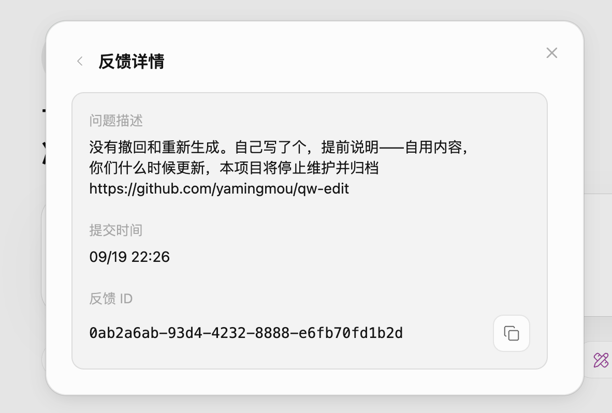

# qw-edit

**这个仓库已经收尾了 —— 功能官方做了，工具用不上了。**

千问办公现在原生支持这四件事：**重新编辑**已发送的消息、**重新生成**本轮回答、**派生任务**（分支）、把会话**删除到回收站**。做得比我好。所以这里收工。

从提反馈到今天（11.25），要带娃很忙，也顾不上去查看最近的版本。现在我确认了这些功能官方都有，就特意写个说明，把这个仓库收尾。

---

## 我原本为什么要写它

2026 年 9 月，我日常在用千问办公，只有一件事反复别扭：**消息发出去就改不了了。** 想改，没有入口；想撤回，也没有。一句话说错，只能另开一个会话从头再来。

于是 **9 月 19 日 22:26**，我给官方提了一条反馈（反馈 ID `0ab2a6ab-93d4-4232-8888-e6fb70fd1b2d`）：

> 没有撤回和重新生成。自己写了个，提前说明——自用内容，你们什么时候更新，本项目将停止维护并归档
> https://github.com/yamingmou/qw-edit



那条反馈里就已经写明了退出条件：**官方什么时候更新，这个项目就停止维护并归档。**

然后我花了两个多月，把这个洞补上：编辑撤回、重新生成、消息时间、会话删除与回收站。其中最难的一件事不是"在界面上加个按钮"，而是让撤回**真的撤回**——界面上删掉、模型却还记得，那是假动作。最后靠"截断会话记录 → 让客户端自己重建上下文"的办法做到：被撤回的内容按构造就不可能再进入模型。

## 官方做对了什么

| 我当时要的 | 官方现在提供的 |
|---|---|
| 编辑已发送的消息并重发 | **重新编辑**（悬停自己发的消息） |
| 重新生成某条回答 | **重新生成**（明确提示"本轮已经生成的内容将不再保留"） |
| 从某条消息分出另一条路 | **派生任务**（分支，"原来的任务不受影响"） |
| 删除会话（官方只有归档） | **删除到回收站 / 归档 / 永久删除** |

特别说一句「重新生成」。官方给的两句提示是：

> 点击重新生成，本轮已经生成的内容将不再保留，请谨慎操作
>
> 本轮上下文无法安全回退，已保留原结果。

这两句话，恰好是我踩了最多坑才想明白的两件事：一是**撤回必须连上下文一起撤**（否则模型带着旧记忆重答，等于没撤）；二是**撤不干净就不要撤**（宁可保住原结果，也不要给一个"界面删了、模型还记得"的假动作）。官方想到的和我撞在了一起——这大概就是一个需求被真正解决时该有的样子。

我不知道官方是不是因为那条反馈才做的。但结果就是：**我提的那个洞，被填上了。**

## 这个项目真正留下的东西

不是那四个功能。功能官方迟早都会做。

留下的是一条被验证过的路：

> **当官方不提供某项能力时，可以在不修改客户端本体、不重打包、不破坏代码签名、不动用户数据的前提下，把能力补上去。**

### 为什么这值得说

遇到"客户端差一个功能"，通常只有三条路，各有明确的代价：

| 路 | 代价 |
|---|---|
| **改包**（解包 `app.asar`，改代码，重打包） | 签名失效 → macOS 拒启动或 Gatekeeper 拦截；客户端每次自动更新都覆盖你的改动，要重做；一旦动了数据模型，官方更新后可能直接损坏会话 |
| **等官方** | 不知道要等多久（这个需求从提反馈到我收工，隔了 **67 天**）；等的期间每天都要用 |
| **不侵入式补全** | 开一个调试端口（本机任意程序可连）；跟版本耦合，官方改结构就失效 —— **但客户端本体、签名、数据一个都没动，失效时也坏不了任何东西** |

第三条路的关键差别在于：**它失败的方式是安全的。** 改包失败可能弄丢会话；补丁失效只是按钮不出现，你的数据、你的客户端、你的更新全都不受影响。

这不是理论上的差别 —— 开发期间客户端升过好几版，我手上经过的是 1.2.5 → 1.3.2 → 1.4.0 → 1.5.0，每升一版都得重新验一遍核心链路（1.3.2 只需复检，接口没变；1.4.0 换了会话引擎和输入框，改动最大）。这期间我重装过、重启过、改错过很多次，**一次都没有影响过客户端本身的正常使用，也没有丢过一条会话**。

### 具体怎么走通的

1. 客户端是 Electron —— 它天生带一个调试口（Chrome DevTools Protocol）；
2. 用启动参数把调试口打开 —— 注入一段脚本；
3. 脚本**不自己造数据**，而是调用客户端**自己**的内部接口去完成动作：改消息、截断上下文、删会话，跑的都是官方自己的代码；
4. 界面上缺的入口，用 DOM 挂载补上去。

三条自己划的线，两个多月一次没越过：

- **不改客户端本体** —— `app.asar` 一个字节没动，客户端自动更新不受影响；
- **不改用户数据** —— 不直接写数据库、不直接改转录文件；回退走官方原语，原转录留在磁盘作审计轨迹；
- **不联网** —— 唯一的连接是本机 `127.0.0.1` 的调试端口，工具自身不发起任何网络请求。

代价也很实在：需要开调试端口（本机任何程序都能连上）、**跟版本强耦合**（客户端一改消息容器的类名，我挂的按钮就全挂不上了——这次收尾时打开 2.1.0 看到的就是这个）、每次官方升级都要重新适配。

**这正是它该结束的第二个理由：第三方补丁永远追不上官方迭代，也不该去追。**

## 最难的一课：别做"假装成功"

这条路真正难的不是"把按钮画出来"，而是**别骗人**。

我踩过两次这个坑：

**假回退** —— 早期我只截断了界面上的消息（投影表），模型真正的上下文（会话转录）原封不动。界面看起来撤回了，可重新生成时模型全都记得。**界面撤了、脑子没撤。** 这个坑逼我推倒重做了整套回退机制。

**假输入** —— 客户端 1.4.0 换成自定义富文本编辑器后，程序写进去的文字只是视觉假象，内部模型根本没收到。界面上有字，点发送无事发生。而且它在自动化测试里表现为"发送成功"，把人骗了很久。

这两件事让我定下一条规矩，也是这个项目最值钱的工程结论：

> **宁可失败，也不要静默半成功。**

落到做法上：

- 每个写操作完成后，去**文件层/数据层**验证一次（行数、内容、指针），不许只信返回值；
- 定位不到目标就停下来报错，**不许猜一个最像的**（重复文本、窗口化列表下猜错就会作用到别的消息上）；
- 破坏性操作前二次确认，并且要说清**会失去什么** —— 写"该消息之后的所有内容会被移除"，而不是"确定吗？"。

在这个项目里，它具体表现成：撤回失败时弹出「本轮上下文无法安全回退，已保留原结果」，**什么都不做**。巧合的是，官方「重新生成」的提示里也写了几乎一样的一句。

## 它证明了什么

一句话：**"官方没做"不等于"做不到"，也不等于"只能等"。**

在一个不开源、不能改包的客户端上，一个普通用户仍然可以把缺的那一步补上，而且不必承担改坏客户端、弄丢数据的风险。这条路不限于千问办公——任何 Electron 客户端、任何"官方差一步"的需求，都是同一条路。

方法论整理在 [docs/non-invasive-extension.md](./docs/non-invasive-extension.md)（[GitHub 上查看](https://github.com/yamingmou/qw-edit/blob/main/docs/non-invasive-extension.md)），可复用的判断清单已沉淀为技能 `electron-client-capability-extension`。

开发过程本身也留档了：[docs/history.md](./docs/history.md) —— 按时间顺序记下每一次"我以为好了"和"其实没好"，以及它们各自是怎么被发现的。开发期的验证脚本全部保留在 [`tools/`](./tools/README.md)（路径已脱敏），它们是这段过程唯一的原始痕迹。

## 历史功能（存档，不再维护）

> ⚠️ **官方现在已有这些功能；本仓库代码在最新版客户端上已失效**（客户端把消息容器类名从 `container/user-message` 改成 `session-user`，注入的按钮无法挂载）。以下仅作技术记录。

| 能力 | 当时的做法 |
|---|---|
| **编辑撤回** | 悬停自己发的消息 → 撤回该消息及之后全部内容 → 原文弹出编辑 → 重新发送 |
| **重新生成** | 悬停某条回答 → 撤回该回答及之后内容 → 用原提问重跑 |
| **消息时间** | 给每条 AI 回答补上发送时间，与用户消息的官方时间同款 |
| **会话删除 · 回收站** | 侧边栏悬停 🗑 移入回收站；顶部回收站弹窗支持多选恢复 / 彻底删除 / 一键清空 |

核心机制（"真失忆"）：**截断投影 → 会话指向全新 id → 客户端下次发送时自动从截断后的投影重建转录**。被撤回的内容不在投影里，也就不可能进入模型上下文。旧转录留在磁盘，一个字节不改。

## 如果你还在用旧版客户端

```bash
git clone https://github.com/yamingmou/qw-edit.git qw-edit
cd qw-edit
node bin/qw-edit.js install     # 安装
node bin/qw-edit.js uninstall   # 卸载（建议：直接用官方功能）
node bin/qw-edit.js status      # 状态
```

需要 Node.js ≥ 22。日志：`~/.qw-edit/daemon.log`。

**安全提示**：本工具依赖客户端调试端口（`127.0.0.1:9222`），开启后本机任何程序都能连上并控制客户端。请勿在不受信任或多人共用的机器上使用。

## 免责声明

**这不是官方工具。** 本项目由个人开发，与千问办公团队、阿里云及 QwenWork 官方**没有任何关联**，未获官方认可或授权。千问办公及 QwenWork 名称归其官方团队所有。

本工具按「现状」提供，不附带任何保证。**不修改客户端本体不等于被官方允许** —— 客户端的使用条款可能限制自动化控制或修改运行行为，请在安装前自行确认相关条款。使用第三方工具增强客户端产生的任何后果（包括功能失效、会话数据变化）由使用者自行承担。

本项目已归档停更（收尾说明写于 **2026-11-25**）。**功能官方已经做了**，请直接使用客户端原生能力；本仓库不再提供更新与支持。

## 许可

[MIT](./LICENSE)

---

*一个自用工具，用完即弃。它最好的结局就是被官方取代。*
